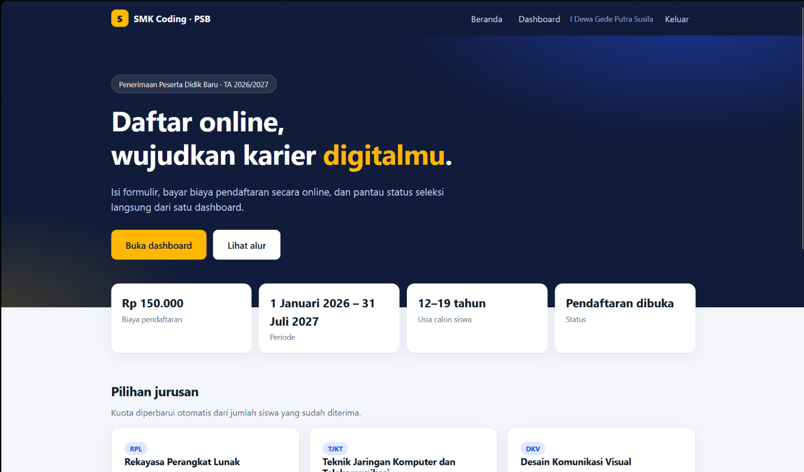
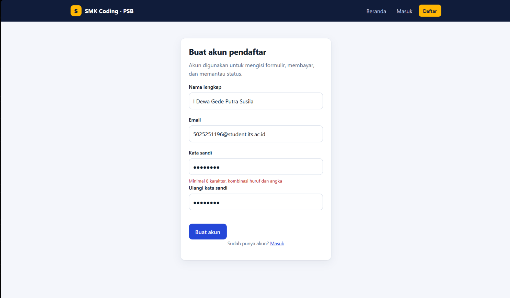
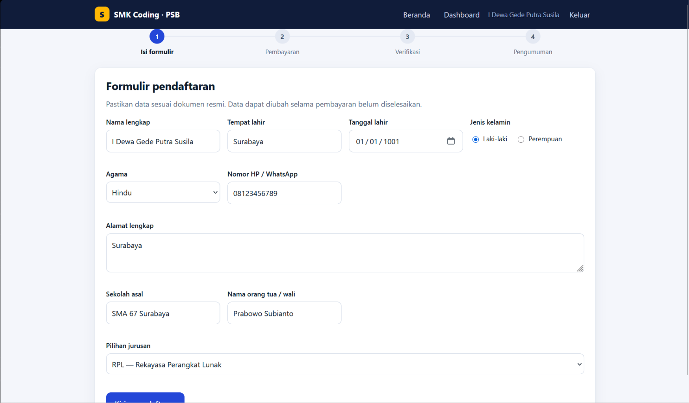
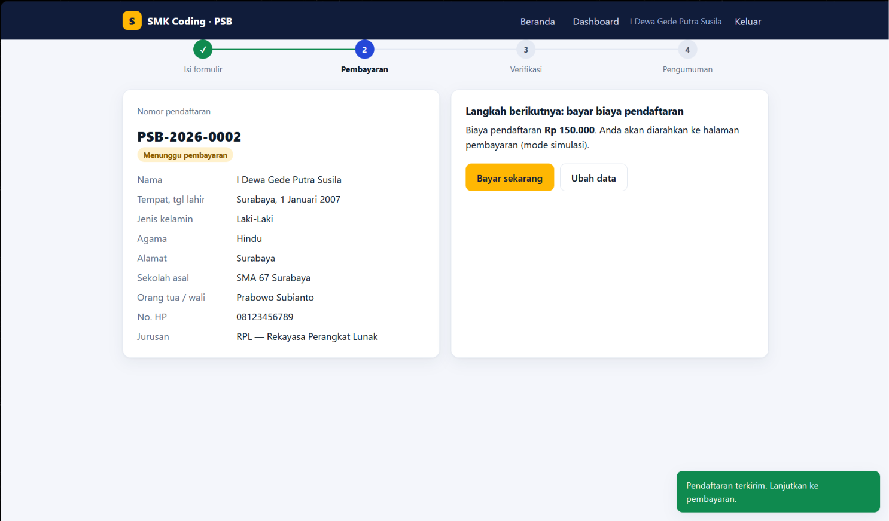
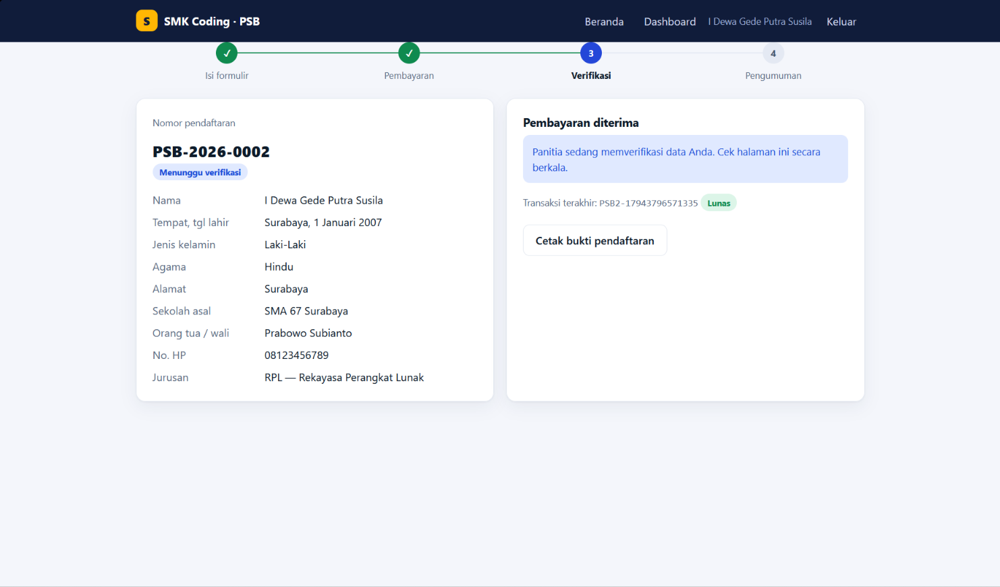
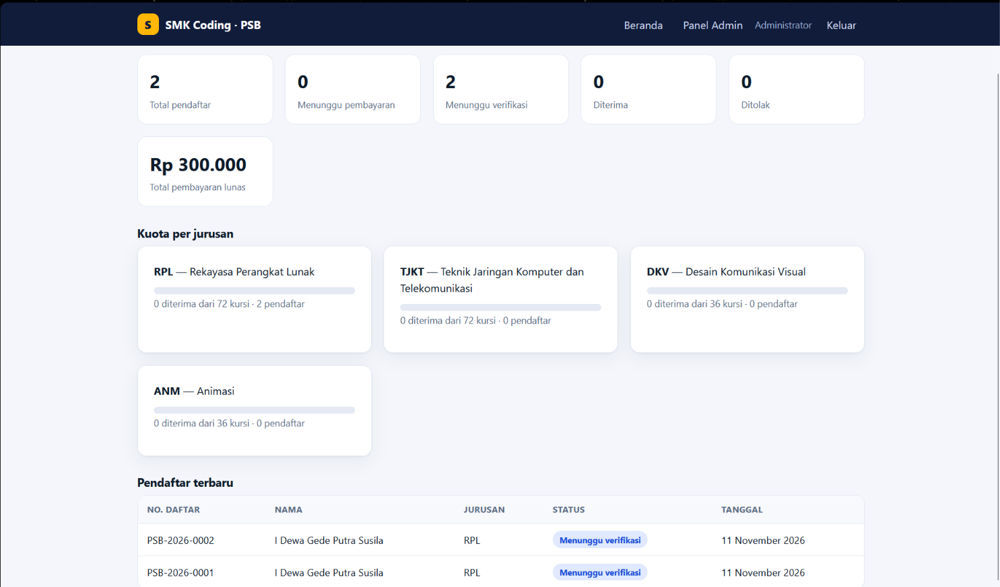
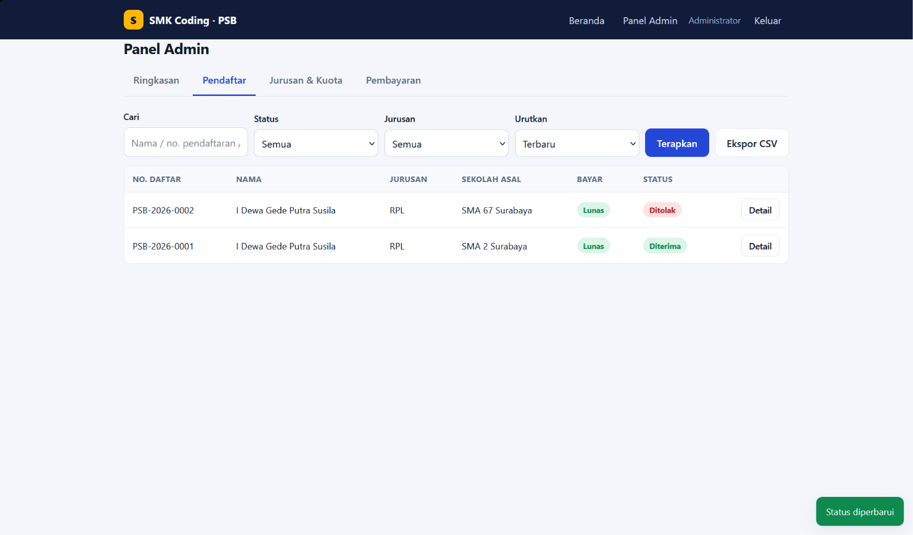
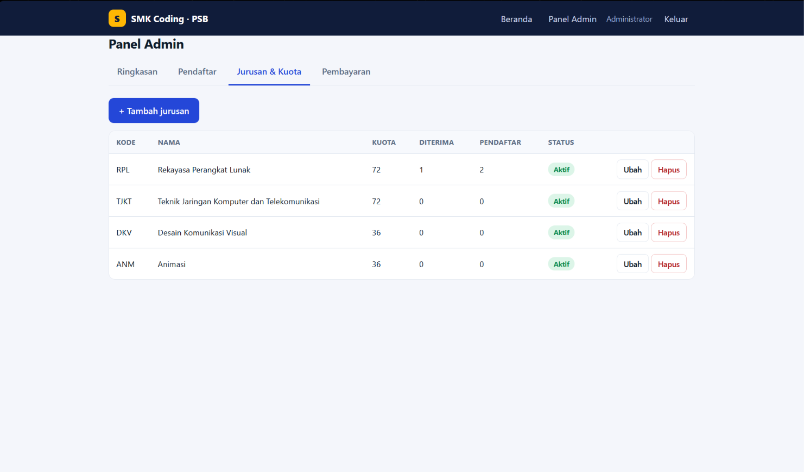
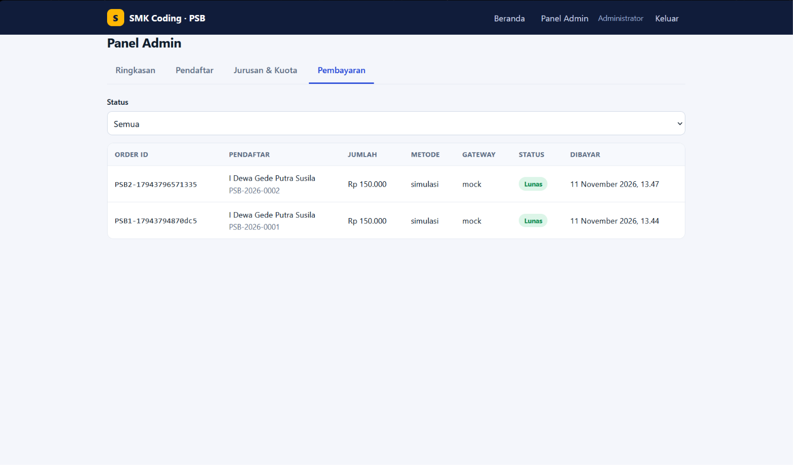

# Sistem Informasi Pendaftaran Siswa Baru (PSB) Online – SMK Coding

| | |
|---|---|
| **Nama** | I Dewa Gede Putra Susila |
| **NRP** | 5025251196 |
| **Mata Kuliah** | Pemrograman Web (B) |

## Daftar Isi

1. [Nama Proyek](#1-nama-proyek)
2. [Deskripsi](#2-deskripsi)
3. [Tujuan](#3-tujuan)
4. [Pengguna dan Peran](#4-pengguna-dan-peran)
5. [Fitur](#5-fitur)
6. [Ruang Lingkup Proyek](#6-ruang-lingkup-proyek)
7. [Arsitektur dan Teknologi](#7-arsitektur-dan-teknologi)
8. [Kebutuhan Non-Fungsional](#8-kebutuhan-non-fungsional)
9. [Rencana Implementasi](#9-rencana-implementasi)
10. [Cara Menjalankan](#10-cara-menjalankan)
11. [Dokumentasi](#11-dokumentasi)

---

## 1. Nama Proyek

**Sistem Informasi Pendaftaran Siswa Baru (PSB) Online – SMK Coding**

Pengembangan dari tutorial CRUD PHP–MySQL ([petanikode/tutorial-php-mysql](https://github.com/petanikode/tutorial-php-mysql)) menjadi aplikasi web dengan arsitektur Front End dan Back End terpisah, dilengkapi autentikasi, logika seleksi, dan pembayaran online melalui payment gateway.

## 2. Deskripsi

Aplikasi web untuk mengelola seluruh proses penerimaan peserta didik baru: calon siswa membuat akun, mengisi formulir, membayar biaya pendaftaran secara online, dan memantau status seleksi. Panitia (admin) memverifikasi data, menetapkan keputusan diterima atau ditolak berdasarkan kuota jurusan, serta memantau statistik dan pembayaran.

Aplikasi tutorial awal hanya memiliki empat operasi CRUD pada satu tabel (`calon_siswa`) tanpa login, tanpa validasi, dan memakai query string mentah yang rentan SQL injection. Proyek ini menutup celah tersebut dan menambahkan proses bisnis yang utuh.

## 3. Tujuan

**Tujuan umum:** mengganti pendaftaran manual (kertas/WhatsApp) dengan proses digital yang cepat, transparan, dan aman.

**Tujuan khusus (terukur):**

- Calon siswa dapat menyelesaikan pendaftaran sampai pembayaran dalam kurang dari 10 menit.
- Data pendaftar tersimpan terpusat, tervalidasi, dan dapat dicari, difilter, serta diekspor (CSV) oleh panitia.
- Pembayaran biaya pendaftaran tercatat otomatis lewat payment gateway tanpa input manual panitia.
- Jumlah siswa diterima tidak pernah melebihi kuota tiap jurusan.
- Seluruh data pribadi dilindungi oleh autentikasi, otorisasi per peran, dan praktik keamanan web standar (kelas OWASP Top 10).

## 4. Pengguna dan Peran

| Peran | Hak akses |
|---|---|
| Pengunjung | Melihat informasi sekolah, jurusan, kuota, biaya, dan jadwal |
| Pendaftar | Registrasi, login, mengisi dan mengubah formulir sendiri, membayar, melihat status, mencetak bukti |
| Admin | Semua data pendaftar, keputusan seleksi, kelola jurusan dan kuota, pantau pembayaran, ekspor data |

## 5. Fitur

### 5.1 Front End (HTML, CSS, JavaScript)

| Halaman | Fitur |
|---|---|
| Beranda | Informasi periode, biaya, usia, daftar jurusan dengan indikator kuota real-time, alur pendaftaran |
| Registrasi dan Login | Validasi sisi klien, pesan galat per kolom, pengalihan otomatis sesuai peran |
| Dashboard pendaftar | Stepper progres (Formulir → Pembayaran → Verifikasi → Pengumuman), formulir pendaftaran, ubah data, tombol bayar, cetak bukti pendaftaran |
| Halaman pembayaran | Layar simulasi (mode demo) dan halaman hasil pembayaran (lunas/pending/gagal/kedaluwarsa) |
| Panel admin | Ringkasan statistik, tabel pendaftar (cari, filter, urut, halaman), detail dan keputusan seleksi, kelola jurusan, daftar transaksi, ekspor CSV |

**Prinsip antarmuka:** responsif (ponsel sampai desktop), label dan pesan galat berbahasa Indonesia, kontras warna memadai, navigasi keyboard, dan gaya cetak untuk bukti pendaftaran.

### 5.2 Back End (PHP 7.4+, MySQL, REST API JSON)

- Layanan autentikasi: registrasi, login, logout, sesi.
- Layanan data pendaftar: CRUD dengan validasi dan aturan peran.
- Layanan jurusan dan kuota.
- Layanan pembayaran: membuat transaksi, sinkron status, menerima webhook gateway.
- Layanan dashboard statistik dan ekspor CSV.

## 6. Ruang Lingkup Proyek

### 6.1 Pengelolaan Data

- **Entitas:** `users`, `jurusan`, `calon_siswa`, `pembayaran`, `login_attempts`.
- **Relasi:** satu user pendaftar memiliki satu data `calon_siswa`; satu siswa dapat memiliki banyak transaksi `pembayaran`; satu jurusan memiliki banyak siswa. Kunci asing dengan `ON DELETE CASCADE` pada data turunan.
- **Operasi CRUD:** Create (pendaftaran), Read (daftar, detail, pencarian, filter status/jurusan, paginasi), Update (ubah data oleh pendaftar atau admin), Delete (admin; jurusan yang sudah dipakai tidak boleh dihapus, cukup dinonaktifkan).
- **Nomor pendaftaran otomatis:** format `PSB-2026-0001`.
- **Validasi data:** panjang teks, tanggal lahir valid, usia 12–19 tahun, format nomor HP Indonesia, nilai agama dan jenis kelamin dari daftar resmi, jurusan harus aktif.
- **Ekspor:** CSV berstandar UTF-8 dengan perlindungan formula injection.
- **Integritas:** transaksi database (`BEGIN`/`COMMIT`) untuk operasi multi-langkah.

### 6.2 Logika Bisnis

**Alur status pendaftar:**

```
menunggu_pembayaran → (pembayaran lunas) → menunggu_verifikasi → (keputusan admin) → diterima | ditolak
```

**Aturan:**

1. Pendaftaran hanya dapat dilakukan dalam periode buka–tutup yang dikonfigurasi.
2. Satu akun hanya boleh memiliki satu pendaftaran.
3. Pendaftar hanya dapat mengubah data selama status masih `menunggu_pembayaran`.
4. Admin tidak dapat memberi keputusan seleksi sebelum pembayaran lunas.
5. Status `diterima` memeriksa kuota jurusan di dalam transaksi dengan penguncian baris (`SELECT ... FOR UPDATE`) agar aman dari dua admin yang menerima bersamaan.
6. Status `ditolak` wajib disertai alasan yang tampil kepada pendaftar.
7. Pembayaran lunas otomatis menggeser status pendaftar ke `menunggu_verifikasi`.
8. Transaksi pending yang masih berlaku dipakai ulang; transaksi gagal atau kedaluwarsa dapat diulang dengan order baru.

### 6.3 Autentikasi dan Security

| Ancaman | Kontrol |
|---|---|
| Pencurian kredensial | Kata sandi di-hash dengan `password_hash()` (bcrypt), minimal 8 karakter huruf + angka |
| Brute force | Pembatasan 5 percobaan gagal per email+IP selama 15 menit; pesan galat login generik |
| SQL injection | Seluruh query memakai PDO prepared statement, emulasi prepare dimatikan |
| XSS | Escape semua output di frontend, Content-Security-Policy, tanpa inline script/style |
| CSRF | Token acak per sesi pada header `X-CSRF-Token` untuk semua request POST/PUT/PATCH/DELETE; token dirotasi saat login |
| Session hijacking/fixation | Cookie `HttpOnly`, `SameSite=Lax`, `Secure` di HTTPS, `session_regenerate_id()` saat login/logout, strict mode |
| Akses tidak sah (IDOR) | Otorisasi per peran dan per kepemilikan di setiap endpoint; pendaftar hanya dapat mengakses datanya sendiri |
| Pemalsuan webhook | Verifikasi `signature_key` SHA-512 dan pencocokan nominal sebelum status diubah |
| Kebocoran informasi | Galat server dicatat di log, klien hanya menerima pesan umum; header `X-Content-Type-Options`, `X-Frame-Options`, `Referrer-Policy` |
| Kebocoran rahasia | Kunci gateway dan kredensial DB lewat environment variable, tidak disimpan di repositori |

### 6.4 API (Application Programming Interface) dan Payment Gateway

**API internal (REST, JSON):**

| Endpoint | Metode | Akses | Fungsi |
|---|---|---|---|
| `/api/auth.php?action=register\|login\|logout\|me\|csrf` | GET/POST | Publik | Autentikasi dan sesi |
| `/api/siswa.php` | GET, POST, PUT | Pendaftar | Data pendaftaran milik sendiri |
| `/api/siswa.php[?id=]` | GET, PUT, PATCH, DELETE | Admin | Daftar, detail, ubah, keputusan seleksi, hapus |
| `/api/jurusan.php` | GET | Publik | Jurusan, kuota terisi, informasi periode dan biaya |
| `/api/jurusan.php` | POST, PUT, DELETE | Admin | Kelola jurusan dan kuota |
| `/api/pembayaran.php?action=create` | POST | Pendaftar | Membuat transaksi dan tautan bayar |
| `/api/pembayaran.php?action=status` | GET | Pemilik/Admin | Cek dan sinkron status transaksi |
| `/api/pembayaran.php?action=notify` | POST | Gateway | Webhook notifikasi pembayaran |
| `/api/pembayaran.php?action=list` | GET | Admin | Riwayat transaksi |
| `/api/dashboard.php`, `/api/export.php` | GET | Admin | Statistik dan ekspor CSV |

**Konvensi respons:** `{ ok: true, data: ... }` untuk sukses dan `{ ok: false, message, errors: { kolom: pesan } }` untuk galat, dengan kode HTTP semestinya (401, 403, 409, 419, 422, 429).

**Integrasi payment gateway (Midtrans Snap):**

1. Pendaftar menekan **Bayar**; backend membuat `order_id` unik dan memanggil Snap API (`POST /snap/v1/transactions`) dengan Server Key via HTTP Basic Auth di sisi server.
2. Backend menyimpan transaksi berstatus `pending` dan mengembalikan `redirect_url`; browser dialihkan ke halaman pembayaran Midtrans.
3. Setelah bayar, Midtrans mengirim notifikasi HTTP ke webhook backend. Backend memverifikasi `signature_key = SHA512(order_id + status_code + gross_amount + ServerKey)` dan kecocokan nominal, lalu memperbarui status secara idempoten.
4. Sebagai cadangan, saat pengguna kembali ke halaman hasil, backend menyinkronkan status melalui Status API.
5. Pemetaan status: `settlement`/`capture` → lunas; `pending` → menunggu; `deny`/`cancel` → gagal; `expire` → kedaluwarsa.

Mode `mock` disediakan agar sistem dapat didemonstrasikan tanpa akun gateway; peralihan ke Midtrans cukup mengubah konfigurasi.

## 7. Arsitektur dan Teknologi

```
Browser (Front End statis) ── fetch JSON + cookie sesi ──► Back End PHP (REST API) ──► MySQL
                                                              │
                                                              └── HTTPS ──► Midtrans (Snap API, webhook)
```

| Lapisan | Teknologi |
|---|---|
| Front End | HTML5, CSS3 (tanpa framework), JavaScript ES2018 (fetch API) |
| Back End | PHP 7.4+ (PDO, cURL, mbstring), arsitektur endpoint per sumber daya |
| Database | MySQL/MariaDB, InnoDB, charset utf8mb4 |
| Server | Apache (XAMPP/Laragon untuk pengembangan) |
| Payment | Midtrans Snap (sandbox lalu produksi) |

Struktur folder:

```
pendaftaran-siswa-baru/
├── database/schema.sql      # skema MySQL + data awal (jurusan, akun admin)
├── backend/
│   ├── config/config.php    # DB, keamanan, biaya, payment gateway
│   ├── includes/            # bootstrap (sesi, CSRF, helper), validasi
│   └── api/                 # auth, siswa, jurusan, pembayaran, dashboard, export
└── frontend/                # index, login, register, dashboard, admin, halaman pembayaran
```

## 8. Kebutuhan Non-Fungsional

- **Kinerja:** respons API di bawah 500 ms untuk 1.000 pendaftar; paginasi sisi server.
- **Ketersediaan data:** pencadangan database harian pada masa pendaftaran.
- **Kegunaan:** dapat dipakai di ponsel; pesan galat jelas dan berbahasa Indonesia.
- **Keamanan dan privasi:** HTTPS wajib di produksi; data pribadi siswa hanya diakses peran berwenang.
- **Pemeliharaan:** kode modular, konfigurasi terpusat di satu berkas, dokumentasi README.

## 9. Rencana Implementasi

| Fase | Minggu | Aktivitas | Output |
|---|---|---|---|
| 1. Analisis dan perancangan | 1 | Kumpulkan kebutuhan, tentukan aturan seleksi, rancang ERD, alur status, dan wireframe | Dokumen spesifikasi, ERD, wireframe |
| 2. Basis data dan fondasi back end | 2 | Skema MySQL, konfigurasi, bootstrap (sesi, CSRF, validasi), autentikasi | `schema.sql`, API auth |
| 3. Pengelolaan data dan logika bisnis | 3 | API siswa, jurusan, aturan status, kuota, nomor pendaftaran, ekspor | API siswa/jurusan/dashboard/export |
| 4. Front End | 3–4 | Halaman publik, registrasi/login, dashboard pendaftar, panel admin | Antarmuka lengkap |
| 5. Integrasi payment gateway | 5 | Mode mock, integrasi Midtrans sandbox, webhook, sinkron status | API pembayaran, halaman hasil |
| 6. Pengujian | 5–6 | Uji fungsional, uji keamanan (SQLi, XSS, CSRF, IDOR, brute force), uji kuota bersamaan, uji lintas peramban dan ponsel | Laporan uji, perbaikan bug |
| 7. Deployment dan serah terima | 6 | Hosting dengan HTTPS, kunci produksi, URL webhook publik, pelatihan panitia | Aplikasi live, panduan pengguna |

## 10. Cara Menjalankan

1. Letakkan folder proyek di `htdocs` (mis. `C:\xampp\htdocs\pendaftaran-siswa-baru`). Dibutuhkan **PHP 7.4+** dengan ekstensi `pdo_mysql`, `curl`, dan `mbstring`.
2. Jalankan Apache dan MySQL, lalu impor `database/schema.sql` lewat phpMyAdmin.
3. Sesuaikan `backend/config/config.php` bila user/password MySQL berbeda (default XAMPP: `root` / kosong).
4. Buka `http://localhost/pendaftaran-siswa-baru/frontend/`.

**Akun admin awal:** `admin@smkcoding.sch.id` / `Admin#12345` — segera ganti setelah login pertama. Pendaftar membuat akun sendiri lewat halaman **Daftar**.

**Payment gateway:** default `payment.mode = 'mock'` (halaman simulasi tanpa akun gateway). Untuk Midtrans sandbox, atur `PAYMENT_MODE=midtrans` dan `MIDTRANS_SERVER_KEY`, lalu arahkan *Payment Notification URL* di dashboard Midtrans ke `https://DOMAIN-ANDA/backend/api/pembayaran.php?action=notify` (harus URL publik; di localhost gunakan ngrok atau cloudflared).

## 11. Dokumentasi

### 11.1 Main Page



### 11.2 Pendaftaran oleh Pengguna

**Registrasi**



**Pengisian Formulir Pendaftaran dan Pembayaran**





### 11.3 Sistem Kelola oleh Admin





